<!-- Rajveer-code/Rajveer-code : profile README. Statuses copy D:\grad_school_applications\TRUTH.md (2026-10-19 block). -->
<meta name="google-site-verification" content="ulma8pVtPkxh6YRWcrvCQVg2ka8wKrE75kA-Pf2MDpU" />

**Rajveer Singh Pall** · B.Tech Computer Science &amp; Business Systems, Gyan Ganga Institute of Technology and Sciences, Jabalpur, India

[Research website](https://rajveer-research.vercel.app/) · [Google Scholar](https://scholar.google.com/citations?user=47CvVCcAAAAJ) · [ORCID 0009-0001-6762-6134](https://orcid.org/0009-0001-6762-6134) · [LinkedIn](https://www.linkedin.com/in/rajveer-singh-pall) · [rajveerpall04@gmail.com](mailto:rajveerpall04@gmail.com)

<table>
  <tr>
    <td valign="top"></td>
    <td valign="top"></td>
  </tr>
</table>

## Research

**A headline metric can look fine while the deployed system fails.** I study where that gap opens and how to measure it honestly:

- **Populations change.** A diabetes model loses 0.077 AUC on an external national survey and serves the oldest adults worst.
- **Metrics and decisions disagree.** Federated training improves subgroup AUC yet flags fewer Black patients at a fixed screening capacity.
- **The scorer changes.** Swapping only the answer verifier on an LLM leaderboard reverses 15.9% of pairwise orderings.
- **The network changes.** Flow-based DoS detectors moved to a new network rank attacks *below* benign traffic.

That last result is where my work is heading: **AI security**, where an attacker can exploit the same gap.

## Papers

**Published**
- **Comprehensive Evaluation of Machine Learning for Type 2 Diabetes Risk Prediction: Large-Scale External Validation and Fairness Analysis.**
  R. S. Pall, S. Yadav, S. Bhalerao, S. Sahu, R. Ahluwalia, B. Awadhiya. *IEEE CIPHER-2026* (IEEE Xplore).
  [DOI](https://doi.org/10.1109/CIPHER70417.2026.11523789) · [arXiv 2607.16253](https://arxiv.org/abs/2607.16253) · [code](https://github.com/Rajveer-code/Federated-Diabetes)
  NHANES → BRFSS (1.28M respondents): AUC 0.794 → 0.717; adults 60+ reach only 0.607.

**Submitted**
- **Higher AUC, Fewer Cases Flagged: Subgroup Fairness Metrics Can Reverse at the Decision Threshold in Federated Diabetes Screening.** R. S. Pall. Submitted, *ML4H 2026 Findings*. [code](https://github.com/Rajveer-code/Federated-Diabetes)
  FedAvg narrows the White–Black AUC gap (0.0075 → 0.0005), yet a capacity-limited screening policy flags 542 fewer reference-positive Black respondents per 100,000.
- **Which Leaderboard Orderings Survive a Human Reader?** R. S. Pall. Submitted, *DMLR*. [code](https://github.com/Rajveer-code/leaderboard-orderings)
  Changing only the verifier reverses 15.9% of orderings among 3,366 Open LLM Leaderboard models. A 400-item human audit with a stated cross-model assumption certifies 174 of 351 MATH-Hard orderings, each with a breakdown value.

**Under review**
- **Persistent Racial Disparities in U.S. Mortgage Approval: Evidence from 42 Million Applications, 2020–2024.** R. S. Pall. Under review, *Journal of Housing Economics*. [SSRN 6334459](https://ssrn.com/abstract=6334459) · [code](https://github.com/Rajveer-code/hmda-racial-disparities)

**Preprint**
- **IndiaFinBench: An Evaluation Benchmark for LLM Performance on Indian Financial Regulatory Text.** R. S. Pall. [arXiv 2604.19298](https://arxiv.org/abs/2604.19298) · [dataset](https://huggingface.co/datasets/Rajveer-code/IndiaFinBench) · [code](https://github.com/Rajveer-code/IndiaFinBench)

**In preparation**
- **Confidently Wrong: Ranking Inversion in Cross-Network Denial-of-Service Detection.** R. S. Pall. 108 of 240 cross-network evaluations score below ROC-AUC 0.5. Code is released with the preprint.

## Software and data

| | |
|---|---|
| [`fairscope`](https://github.com/Rajveer-code/fairscope) | Subgroup-stratified, calibration-aware fairness auditing for ML models · [PyPI](https://pypi.org/project/fairscope/) |
| [`leaderboard-orderings`](https://github.com/Rajveer-code/leaderboard-orderings) | Verifier audit, human labels and certification code for LLM leaderboards |
| [`trustshift`](https://github.com/Rajveer-code/trustshift) | Four-domain deployment-shift audit: prediction files, result tables, one script per table · [HF dataset](https://huggingface.co/datasets/Rajveer-code/trustshift) |
| [lm-evaluation-harness #4007](https://github.com/EleutherAI/lm-evaluation-harness/issues/4007) | Upstream census: 2,936 of 4,524 generative tasks score an unparseable response as a wrong answer |
| [`sih-2026-bordershield`](https://github.com/Rajveer-code/sih-2026-bordershield) | Smart India Hackathon 2026 team entry: document and identity screening console |

## Service

Program Committee reviewer: W-NUT 2026 and FinNLP 2026 (EMNLP 2026 workshops).
